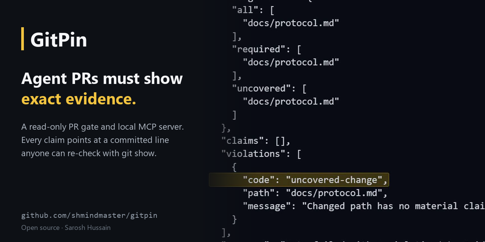
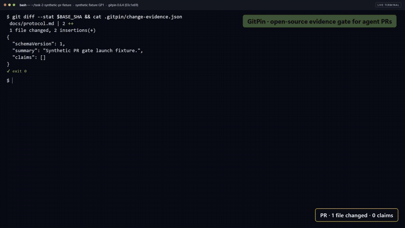
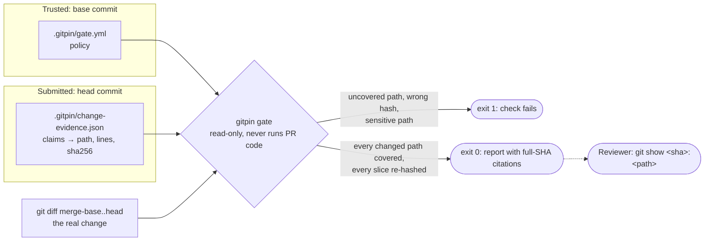

> [!IMPORTANT]
> **Archived 2026-10-15.** Superseded by [Assay](https://github.com/shmindmaster/assay), a reference architecture for deterministic agent control.
> Why: the same agent writes both the change and its evidence manifest, so the gate proves coverage and hash pinning, not that a claim is true. Assay moves the decision into deterministic code instead.
> The last release, 0.6.4, stays on npm. The rest of this README is unchanged.

<div align="center">



# GitPin

### Agent-authored pull requests must show exact evidence before they merge.

**A read-only PR gate and local MCP server that ties every claim an AI agent makes about its change to an exact committed line that anyone can re-check with plain `git`.**

[](https://github.com/shmindmaster/gitpin/actions/workflows/ci.yml)
[](https://www.npmjs.com/package/gitpin)
[](https://registry.modelcontextprotocol.io/v0.1/servers?search=io.github.shmindmaster/gitpin&limit=20)
[](LICENSE)
[](package.json)

[Quickstart](#quickstart-the-gate-in-30-seconds) · [Watch the film](#see-it-run) · [Use it in your repo](#use-it-in-your-repo) · [How it works](#how-it-works) · [Guardrails](#guardrails-and-non-goals) · [Status](#status-and-limits)

</div>

---

## Why it exists

Coding agents now open pull requests with confident descriptions: "added retry
logging", "updated the protocol doc", "no other files touched". A reviewer who
wants to trust one of those sentences has to open the file and hunt for the
line, then do it again for the next sentence. Most reviewers stop checking, and
an agent can change a file it never mentions.

GitPin turns the description into evidence. The agent commits a small manifest
in which every material claim names the paths it covers and points at an exact
line slice with a SHA-256 of its text. A required check compares that manifest
with the real diff. Any changed file that no claim covers fails the build, and
every claim that passes can be re-checked by a human with `git show`, without
GitPin, without the agent and without a hosted platform.

## Quickstart: the gate in 30 seconds

```bash
git clone https://github.com/shmindmaster/gitpin.git && cd gitpin
corepack enable && pnpm install --frozen-lockfile
pnpm demo:gate
```

`demo:gate` builds GitPin, creates a throwaway synthetic repository in a temp
folder, and runs the real `gitpin gate` twice. The agent's first commit changes
`docs/protocol.md` without claiming it, so the gate fails with exit `1`. The
agent adds one evidence locator (line 5, hashed) and the same gate passes with
exit `0`:

```text
$ gitpin gate --base <base> --head <agent-commit>
status: failed   exit code: 1
violation: uncovered-change: Changed path has no material claim: docs/protocol.md.
covered: synthetic-service/docs/overview.md:3 @ <agent-commit> (verified)
$ gitpin gate --base <base> --head <locator-commit>
status: ok   exit code: 0
covered: synthetic-service/docs/overview.md:3 @ <locator-commit> (verified)
covered: synthetic-service/docs/protocol.md:5 @ <locator-commit> (verified)
```

Nothing is written outside the temp folder, and the folder is removed afterward.

## See it run

<a href="https://saroshhussain.com/films/gitpin-the-gate-that-wants-evidence.mp4">
  
</a>

**[Watch the 90-second film →](https://saroshhussain.com/films/gitpin-the-gate-that-wants-evidence.mp4)** ·
**[The 30-second cut →](https://saroshhussain.com/films/gitpin-the-gate-in-30-seconds.mp4)**

## Use it in your repo

**1. Install the trusted policy on your default branch** (a separate, reviewed
change, so a pull request can never weaken its own gate):

```bash
mkdir -p .gitpin
curl -fsSL https://raw.githubusercontent.com/shmindmaster/gitpin/v0.6.4/templates/gate.yml -o .gitpin/gate.yml
```

**2. Make it a required check:**

```yaml
name: Agent delivery assurance
on: pull_request            # never pull_request_target
permissions:
  contents: read
jobs:
  evidence:
    runs-on: ubuntu-latest
    steps:
      - uses: actions/checkout@3d3c42e5aac5ba805825da76410c181273ba90b1 # v7.0.1
        with:
          fetch-depth: 0
          ref: ${{ github.event.pull_request.head.sha }}
      - uses: shmindmaster/gitpin@514799cb0eae55e965e51d510d5e7a0a7604c9cc # v0.6.4
        with:
          base-sha: ${{ github.event.pull_request.base.sha }}
          head-sha: ${{ github.event.pull_request.head.sha }}
```

**3. Each agent PR commits `.gitpin/change-evidence.json`**, starting from
[`templates/change-evidence.json`](templates/change-evidence.json). The full
setup, including rulesets, is in [docs/pr-evidence-gate.md](docs/pr-evidence-gate.md).

**Give your agent the evidence tools.** The local MCP server lets Claude Code,
Codex, Cursor and other MCP clients find candidates and produce the evidence
packs the gate checks:

```bash
# Run inside any committed Git repository
npx -y gitpin@0.6.4 init --client codex      # or claude-code, cursor, windsurf, zed, continue
```

`init` writes `~/.gitpin/repositories.yaml` outside the repository, runs
`doctor`, prints a first evidence line with a full SHA, and prints paste-ready
MCP config. It never edits the repository it registers.

## How it works



The gate reads policy only from the trusted base commit and the manifest only
from the head commit, through `git show`, never from a working tree. It compares
the merge-base diff, re-hashes every cited line slice, and emits a report whose
citations carry full SHAs.

The MCP side follows one loop. Search returns candidates, never answers. Proof
turns a candidate into an evidence pack. Verification re-checks it with
`git show`:

```text
pin.search_docs / pin.search_code   candidates only, with a forced next step
          → pin.prove               evidence pack: path, line, full SHA, content hash
          → pin.verify              independent git show re-check, HEAD match report
          → you: git show <sha>:<path>
```

| Job | Tools (12, all read-only) |
| --- | --- |
| Discover | `pin.catalog` |
| Find candidates | `pin.search_docs`, `pin.search_code` |
| Prove | `pin.prove`, `pin.prove_set` (1 to 8 cites), `pin.get_doc`, `pin.read` |
| Verify | `pin.verify`, `pin.verify_set` |
| Decide | `pin.analyze` → `EvidenceBrief` (known facts, gaps, stable `evidenceSetId`) |
| Inspect and diff | `pin.inspect`, `pin.compare` |

Resource `gitpin://catalog`; prompt `prove-with-git-head`. Cite formats are in
[docs/cite-spec.md](docs/cite-spec.md); an agent skill template is in
[templates/gitpin-skill.md](templates/gitpin-skill.md).

## Guardrails and non-goals

- **Read-only, always.** GitPin never writes, commits or pushes to a repository it reads, and the gate never executes pull-request code.
- **A PR cannot weaken its own gate.** Policy comes from the base commit; evidence comes from the head commit; the dirty working tree is never read.
- **Uncommitted work is never evidence.** Dirty and untracked content is excluded from HEAD citations.
- **Sensitive paths stay sensitive.** Deny rules apply to evidence, and the manifest cannot cite itself.
- **Candidates are not claims.** Search output is labelled `evidence-candidates` and must go through `pin.prove`.
- **No embeddings, no database, no reindex.** Evidence comes from Git objects, so it works offline and on private repositories.

Not goals: semantic search, writing or committing code, replacing GitHub
Issues or PR automation, or treating a non-Git folder as one repository.

## Status and limits

This source tree and its packed documentation describe GitPin 0.6.4 without asserting publication status. Check each channel independently: [npm](https://www.npmjs.com/package/gitpin), the [MCP Registry](https://registry.modelcontextprotocol.io/v0.1/servers?search=io.github.shmindmaster/gitpin&limit=20) (`io.github.shmindmaster/gitpin`) and [GitHub Releases](https://github.com/shmindmaster/gitpin/releases/tag/v0.6.4).
Node 20 or later. Site: [shmindmaster.github.io/gitpin](https://shmindmaster.github.io/gitpin/).

GitPin verifies **coverage, location, revision and content hash**. It proves
what was committed, not that a claim is true: it does not establish semantic
correctness, runtime behavior, authorship, authorization or compliance. That
judgment stays with the reviewer, who now reads one cited line instead of
hunting for it. Planned work is in the [roadmap](ROADMAP.md).

## Configuration

| Variable | Purpose |
| --- | --- |
| `GITPIN_REGISTRY` | Registry YAML path (legacy compatibility alias: `REPOCONTEXT_REGISTRY`) |
| `GITPIN_MCP_TOKEN` | HTTP bearer token (legacy compatibility alias: `REPOCONTEXT_MCP_TOKEN`) |
| `GITPIN_ALLOWED_HOSTS` | HTTP host allowlist (legacy compatibility alias: `REPOCONTEXT_ALLOWED_HOSTS`); required when `HOST` is not loopback |
| `HOST` | HTTP bind address; defaults to `127.0.0.1`. `Dockerfile.remote` sets `0.0.0.0` |

Default registry: `~/.gitpin/repositories.yaml` (legacy compatibility fallback: `~/.repocontext/...` if present).

Formerly RepoContext 0.3.x. See [migration](docs/migration-gitpin.md).

## Docs

[Tools](docs/tools.md) · [PR evidence gate](docs/pr-evidence-gate.md) · [Clients](docs/clients.md) · [Architecture](docs/architecture.md) · [Compare](docs/compare.md) · [FAQ](docs/faq.md) · [Troubleshooting](docs/troubleshooting.md) · [Roadmap](ROADMAP.md) · [Governance](GOVERNANCE.md)

## Contributing, security and license

- **Contributing:** start with an issue for bugs and proposals, then follow
  [CONTRIBUTING.md](CONTRIBUTING.md). Good first issues are labelled
  [`good first issue`](https://github.com/shmindmaster/gitpin/labels/good%20first%20issue).
  Before a pull request: `pnpm validate && pnpm build && pnpm verify:package`.
- **Security:** report vulnerabilities privately through a
  [GitHub security advisory](https://github.com/shmindmaster/gitpin/security/advisories/new),
  as described in [SECURITY.md](SECURITY.md). Please do not open a public issue.
- **License:** [MIT](LICENSE).

Created and maintained by [Sarosh Hussain](https://saroshhussain.com). Related
open source: [Assay](https://github.com/shmindmaster/assay) keeps an agent's
decision out of its side effects; [CrewScore](https://github.com/shmindmaster/crewscore)
checks whether an agent's prompt writes its safeguards down.
