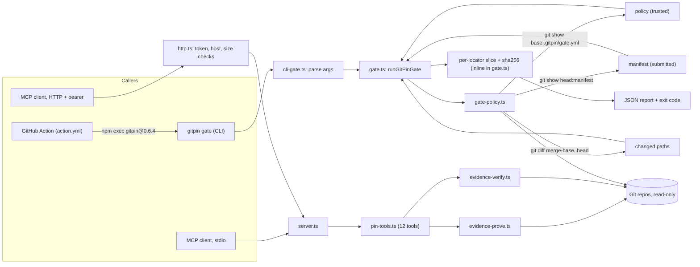

# GitPin Technical Verification

Scope: GitPin 0.6.4. Read from source at `e4c550e`; the suites ran at `90598a1` (see [TESTS.md](TESTS.md)). Existing architecture docs: [docs/architecture.md](../architecture.md), [docs/architecture/overview.md](../architecture/overview.md). This file adds the gate trace and the verification view.

## Architecture

Single TypeScript package, CommonJS, Node 20 or later. Runtime dependencies: `@modelcontextprotocol/sdk`, `simple-git`, `yaml`, `zod`. No frontend app: `site/` is a static page (vanilla JS) built by `scripts/build-site.mjs`.

## Data

- No database, queue, cache or embeddings. Git is the only data store, read through `git show`, `git diff`, `git rev-parse`, `git merge-base`, `git grep` (`execFileSync`, no shell).
- Local files: `repositories.yaml` registry (`GITPIN_REGISTRY`), optional local snapshot index (`GITPIN_INDEX_PATH`, `pnpm index:build`; ignored by Git). The gate does not use either.
- Gate inputs are `.gitpin/gate.yml` and `.gitpin/change-evidence.json`, validated with zod (`src/gate-types.ts`).

## Auth and secrets

- Gate and stdio MCP: no auth; they run as the local user against local repos.
- HTTP MCP: `Authorization: Bearer` compared with `timingSafeEqual` against `GITPIN_MCP_TOKEN` (legacy alias `REPOCONTEXT_MCP_TOKEN`); the server refuses to start without it (`src/http.ts:15`). `GITPIN_ALLOWED_HOSTS` is a Host-header allowlist; `/healthz` skips it. Request size capped at 1 MiB, `content-length` required, no chunked bodies. Default bind is `0.0.0.0` on this commit; PR #102 changes that and is pending, not evaluated here.
- Sensitive paths are blocked at read time (`src/policy.ts`, `isAlwaysSensitivePath`).
- Other environment variable names: `GITPIN_REGISTRY`, `GITPIN_INDEX_PATH`, `HOST`, `PORT`, `GITPIN_MCP_URL`, `POSTHOG_GITPIN_PROJECT_KEY` (site analytics, with an opt-out in `site/analytics.js`). Values were not read. The Action passes `NPM_CONFIG_REGISTRY` and an empty npmrc so npm credentials are not used.
- Gate workflow is `pull_request` with `contents: read`. The docs say never `pull_request_target`.

## CI/CD and release

| Workflow | Trigger | What it does |
| --- | --- | --- |
| `ci.yml` | pull_request, push | `pnpm validate` (node matrix), package job (`verify:package`, `pnpm audit --audit-level high`, `npm pack`), website Playwright job |
| `evidence-gate.yml` | pull_request | Runs the GitPin Action on GitPin itself (self-test), pinned to the 0.6.4 release commit |
| `release.yml` | tag `v*.*.*`, manual | validate, build, `verify:package`, `verify:release-tag`, npm publish |
| `publish-mcp.yml` | manual only | Publishes to the MCP Registry via GitHub OIDC |
| `pages.yml` | manual only | Builds and deploys the site |
| `auto-merge-owner-prs.yml` | PR events | Squash-merge of owner PRs once required checks pass |

Actions are pinned by commit SHA. `pnpm validate` chains lint, format check, typecheck, client config, CI routing, automerge test, env example, MCP registry, release tag, vitest, site build and the fail-to-pass artifact check. It passed on Node 22 and 24 at `90598a1` (Validate run 38736417735; see [TESTS.md](TESTS.md)).

## Observability

Stderr only: a ready line on server start and thrown error messages. HTTP has `GET/HEAD /healthz` (200 ready, 503 not ready). No metrics, tracing or structured logs. The gate's observable output is the JSON report (`reportId`, policy and manifest hashes) and the Action step summary.

## Tech debt

- Gate re-implements the line-slice hash inline (`gate.ts:108-115`) and does not call `evidence-verify.ts`; the two paths can drift.
- `evidence-verify.ts:110` has a no-op ternary (`headMatches ? 'supported' : 'supported'`).
- HTTP builds a new server and transport per request in the stateful-era style; MCP 2026-07-28 migration is not evidenced.
- Exit code 1 means both "gate failed" and "gate could not run".
- Some demo scripts name a local Qwen route (`record-demo-qwen.ps1`); not part of the product runtime.
- Roadmap items not shipped: threat model and abuse-case suite, release provenance, SARIF, OpenSSF Scorecard ([ROADMAP.md](../../ROADMAP.md)).

## Critical-feature trace: `gitpin gate --base <sha> --head <sha>`

Line numbers are for `e4c550e`; none of the traced files changed through `90598a1`. No segment is simulated or a placeholder.

| # | Hop | Where | What happens |
| --- | --- | --- | --- |
| 1 | Entry | `src/server.ts:37-43` | `process.argv[2]` is a command, so `runCli`; a thrown error prints to stderr and exits 1 |
| 2 | Dispatch | `src/cli.ts:49-53` | `command === 'gate'`: run, print `JSON.stringify(report, null, 2)`, set `process.exitCode = exitForVerify(report)` |
| 3 | Arg parsing | `src/cli-gate.ts:3-36` | Loops `--base --head --root --repository --policy`; unknown option or missing value throws; `--base` and `--head` required |
| 4 | Gate start | `src/gate.ts:24-34` | Resolves root, repository name, policy path; `isSafeRelativePath` rejects traversal and absolute paths |
| 5 | Resolve SHAs | `src/gate.ts:35-36`, `src/gate-policy.ts:6-15` | Requires 40 hex chars, then `git rev-parse --verify <sha>^{commit}` |
| 6 | Merge-base | `src/gate.ts:37`, `src/gate-policy.ts:17-23` | `git merge-base base head` |
| 7 | Base policy | `src/gate.ts:38`, `src/gate-policy.ts:25-40` | `git show <base>:.gitpin/gate.yml`, YAML parse, zod `gatePolicySchema` |
| 8 | Head manifest | `src/gate.ts:40-46`, `src/gate-policy.ts:42-58` | `git show <head>:<manifestPath>`, JSON parse, zod `changeEvidenceSchema`; claim count checked against policy limit |
| 9 | Merge-base diff | `src/gate.ts:48`, `src/gate-policy.ts:60-65` | `git diff --name-only --no-renames -z <mergeBase> <head>`; over the limit throws |
| 10 | Required paths and policy block | `src/gate.ts:55-67` | include/exclude globs (`gate.ts:219-244`), manifest excluded, `policy-change-blocked` if the policy file changed |
| 11 | Per-claim checks | `src/gate.ts:70-86` | `evidence-limit`, `duplicate-cover` |
| 12 | Locator guard | `src/gate.ts:95-105` | Manifest self-citation or sensitive path fails the locator |
| 13 | Per-claim line-slice hash | `src/gate.ts:108-115`, `src/gate-policy.ts:75-83` | `git show <base or head sha>:<path>`, split lines, reject range over 200 lines or past EOF, join slice with `\n`, SHA-256, compare to `contentSha256` (`content-hash-mismatch` on difference; `evidence-unavailable` on read error, `gate.ts:135-143`) |
| 14 | Citation | `src/gate.ts:124-133` | `buildCitation` with the full SHA for verified locators |
| 15 | Coverage check | `src/gate.ts:169-173` | Required paths not in any claim's `covers` become `uncovered-change` |
| 16 | JSON report | `src/gate.ts:175-206` | `status` is `ok` only with zero violations; `reportId` is a SHA-256 prefix of the report material |
| 17 | Exit code | `src/cli-verify.ts:20-22` | `status === 'ok'` gives 0, else 1 |

In the Action, hop 1 is replaced by `npm exec --package=gitpin@0.6.4 -- gitpin gate ...` (`action.yml:65-73`), output goes to a report file, then `scripts/render-gate-action-report.mjs` renders it and the step exits with the gate's code.

Executed: the published `gitpin@0.6.4` gate ran on this repository's own history on 2026-10-15. 56fcab9→df94cd3 gave `evidence-verified`, exit 0. 56fcab9→90598a1 gave `uncovered-change` on 2 paths, exit 1 (see [TESTS.md](TESTS.md)). The fail-to-pass run is `src/gate-hero.test.ts` and the films; see [TESTS.md](TESTS.md) and [DEMOS.md](DEMOS.md).
